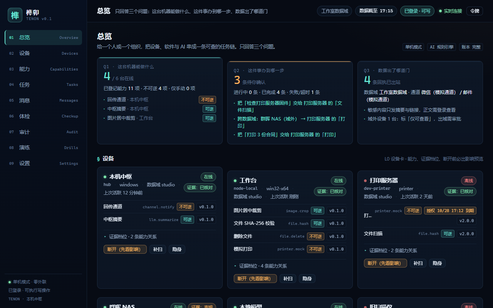
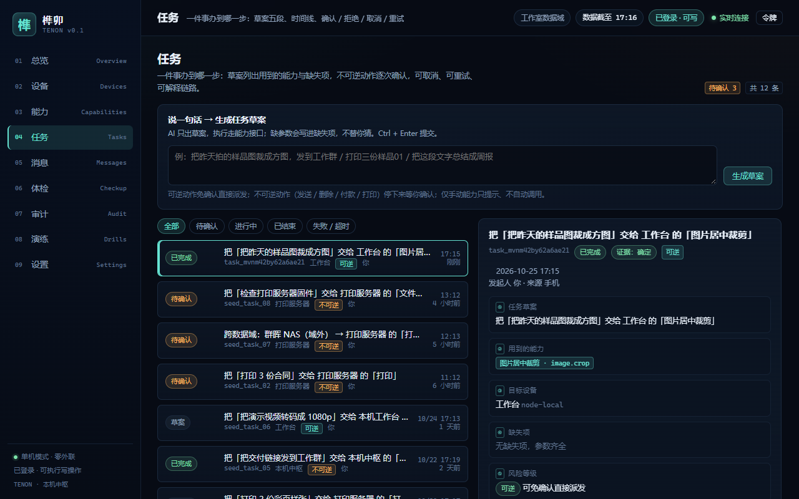
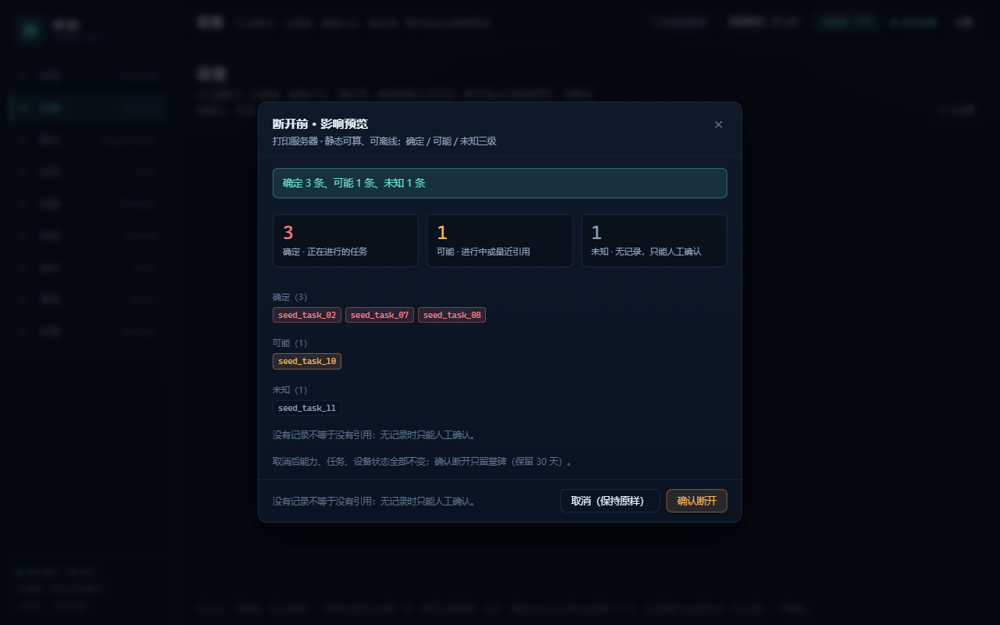
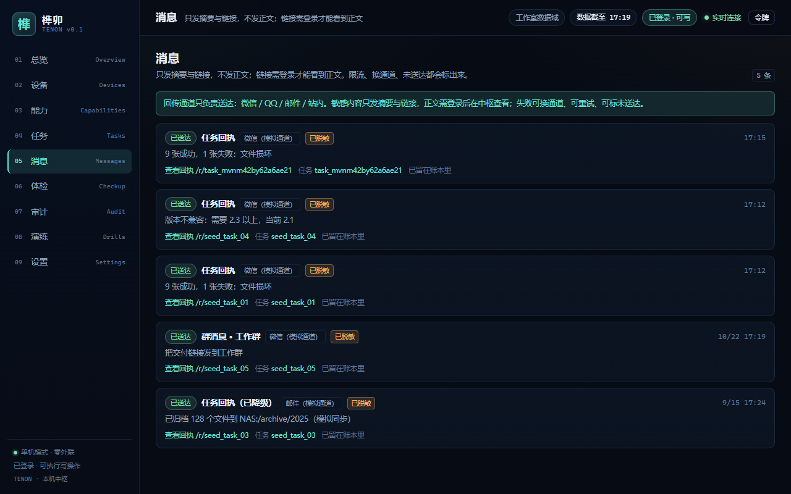
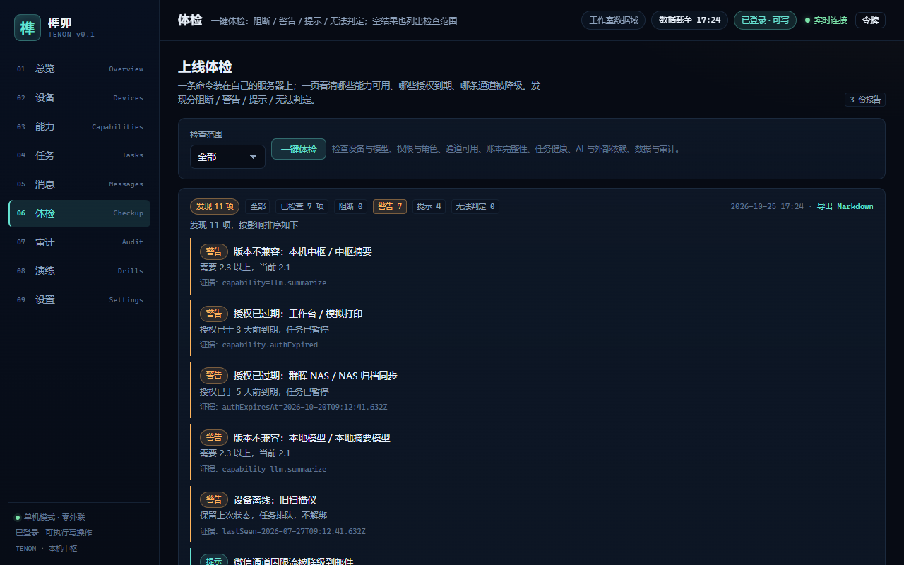
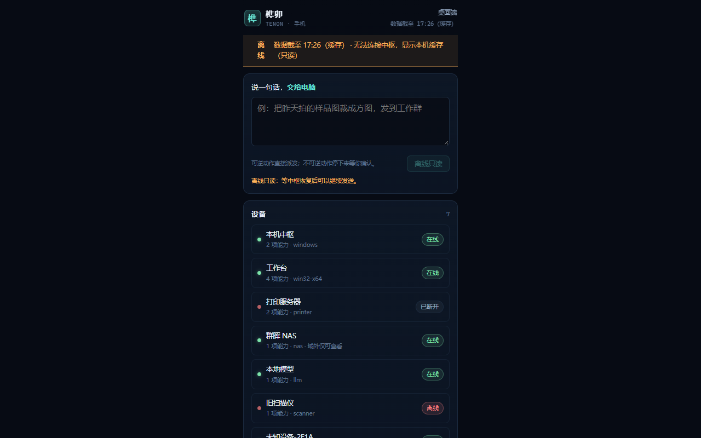
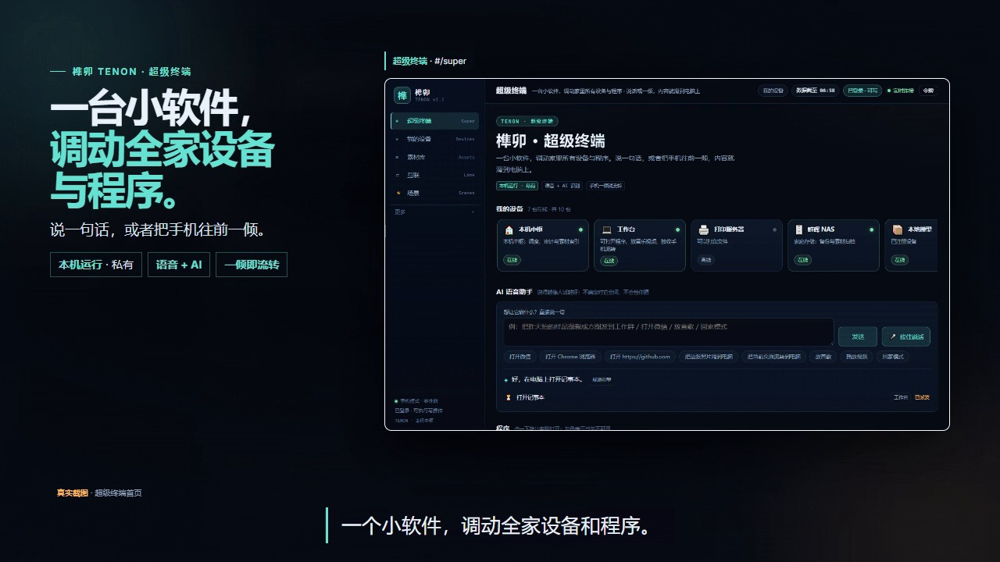

# Tenon (榫卯)

> A self-hostable hub that connects your devices, software and AI into **one auditable task chain**.

[简体中文](README.zh-CN.md) · [Docs](docs/) · [License](LICENSE) · [Commercial use](COMMERCIAL.md) · [Security](SECURITY.md)

**Status: v0.1.0 shipped — 2026-10-25.** The hub, node agent, desktop console and phone page are all runnable: **146 unit tests pass**, **8/8 human-driven real-browser acceptance checks pass**, and an executable real-browser E2E suite (`npm run test:e2e`, 9/9 checks including the read-only regression) ships in the repo. Repository: <https://github.com/minzzj/tenon>.

Evidence: [test results 2026-10-25](docs/测试证据/测试结果-20261025.md) · [JSON](docs/测试证据/测试结果-20261025.json) · [19 evidence screenshots](docs/测试证据/screenshots/).

---

## The three questions

Tenon exists to answer exactly three questions for a person — or a 3–20 person studio, or a team behind an intranet and a compliance officer:

| Question | What you see |
|---|---|
| **What can this machine do?** | A device card: which capabilities it offers, who may use them, evidence for each relation, when authorisations expire |
| **Where is this task now?** | One timeline: drafted, confirmed, queued, running, done/failed, delivered — with evidence for every step |
| **Where did the data go?** | Data-domain labels and an exportable audit trail: which device, which capability, which model, which channel |

Adjacent products optimise *how to connect*. Tenon is about **who approved, how far it got, and where the data went** after the connection. Protocol solves connectivity; a ledger solves responsibility.

## Six capabilities (all shipped in v0.1.0)

| # | Capability | What you get |
|---|---|---|
| 1 | **Auto-discovery** | A node appears with its capabilities as soon as it starts; rescan, hide, read-only join; failures say which step was blocked |
| 2 | **Capability view** | Provider, allowed users, last three calls, authorisation expiry; every relation opens its evidence; no evidence is shown as *unknown* |
| 3 | **Task delegation** | One sentence on a phone becomes a five-part draft on the desktop; irreversible actions need confirmation one by one; cancel and retry |
| 4 | **Impact preview** | Before disconnecting a device or revoking an authorisation: the tasks that would break, graded *certain / possible / unknown*; cancel changes nothing |
| 5 | **Message callback** | Summary + link only, body never leaves the intranet; rate-limit → queue/retry → fallback channel → marked undelivered, all visible |
| 6 | **Deploy & health check** | One page: blocked / warning / notice / undeterminable; an empty result lists what was checked; audit export as CSV / JSON / Markdown |

Capability plugins shipped: node side `image.crop` (pure-JS PNG centre crop), `file.hash`, `file.delete`, `printer.mock`; hub side `channel.notify` and `llm.summarize`.

## Screenshots

> All captured from the real 2026-10-25 run at 1280×800 — not mockups.

**Overview**: one entry point per question; device cards show online state, capabilities and evidence level.



**Tasks**: one sentence becomes a five-part draft (draft / capabilities / target device / missing items / risk). The timeline keeps evidence for every step.



**Impact preview**: before disconnecting a device, see *certain 3 / possible 1 / unknown 1*; cancel and the business state does not change.



**Messages**: summary + link only, with channels explicitly labelled "mock channel"; `/r/<taskId>` links need a token to show the body.



**Health check**: blocked / warning / notice / undeterminable on one page; an empty result lists the checked scope; export to Markdown.



**Phone offline**: when the hub is unreachable, the phone page shows its local cache and a "data as of HH:mm" banner, read-only until the hub returns.



## Quick start (the commands below are all verified)

Requirements: **Node.js >= 22** (tested on Node 24.15.0). Zero runtime dependencies — **no `npm install` needed**.

Get the code: `git clone https://github.com/minzzj/tenon.git`, or download the source zip from the [v0.1.0 release](https://github.com/minzzj/tenon/releases/tag/v0.1.0).

### Windows one-click

1. Open the repository root and double-click `scripts/启动.cmd`.
2. It opens the hub window, the node window and the browser at `http://127.0.0.1:7410`.
3. The first start creates `data/secrets.json`; the hub window prints the operator token you need for write actions.
4. Stop with `scripts/停止.cmd`, or just close the two windows.

### Manual start (any OS)

```bash
cd <repo root>
node server/start.js          # terminal 1: hub on http://127.0.0.1:7410
node node-agent/agent.js      # terminal 2: node agent, connects to the hub
# open http://127.0.0.1:7410 and sign in with the operator token printed in the hub log
```

### Phone (same LAN)

```text
http://<PC-IP>:7410/m
```

- Read-only browsing needs no login; write actions ask for the operator token (printed at start-up or stored as `operatorToken` in `data/secrets.json`).
- The hub listens on `127.0.0.1` by default. For phone access, start it with `TENON_HOST=0.0.0.0` and allow the port through the firewall.

### Configuration (environment variables)

| Variable | Purpose | Default |
|---|---|---|
| `TENON_MODE` | Run-form label: `solo` / `team` / `enterprise` (recorded in the boot event and snapshot; team/enterprise audit retention stays a configuration-layer item — see the assumptions doc) | `solo` |
| `TENON_HOST` | Listen address (use `0.0.0.0` for phone access on the LAN) | `127.0.0.1` |
| `TENON_PORT` | Port | `7410` |
| `TENON_DATA_DIR` | Data directory | `./data` |
| `DEEPSEEK_API_KEY` | Optional: real DeepSeek access; without it the rule engine takes over | unset |

### Demo data

```bash
# reset demo data: 71 events / 11 tasks / 2 checkups / 2 messages / 2 audit exports
node scripts/seed-demo.js --fresh

# regenerate the sample images (needs Pillow: pip install pillow)
python scripts/gen-samples.py
```

## Architecture (shipped in v0.1.0)

```text
[phone page /m]   [desktop console /]   [receipt page /r/<taskId>]
        \               |                 /
                 Hub (Node.js, server/start.js)
  append-only hash-chained ledger · replayed index · capability registry
  task engine · impact preview · channels · health check · AI providers
  HTTP API + SSE
                   |
  Node agent (node-agent/agent.js) — registers capabilities, heartbeats, pulls tasks, reports events
                   |
  node capabilities: image.crop · file.hash · file.delete · printer.mock
  hub capabilities:  channel.notify · llm.summarize
```

## Design principles

- **Local-first.** Everything runs on your machine or your LAN. No vendor cloud in the middle. The public relay is only a reserved interface — it is **not implemented in this version**; the default is zero outbound connections.
- **Evidence over guessing.** Relation strength is *certain / possible / unknown*; a relationship without evidence is shown as unknown, never inferred into a fact.
- **Append-only ledger.** Events carry `seq` and a hash chain and are replayed into an index at start-up — crash recovery, audit, export and migration all read the same source of truth.
- **Zero runtime dependencies.** Node.js built-in modules only; the UI is plain HTML/CSS/JS with no CDN and no external fonts, so the product keeps working with the network unplugged.
- **Plugin boundaries.** AI providers, capabilities and delivery channels are interfaces: this release ships a DeepSeek provider with rule-engine fallback, node capability plugins and mock channels. Swapping in a real channel does not touch the core.

## Testing and evidence (measured 2026-10-25)

Testing is done the way a user uses it: **real Chrome clicks, real files, real process kills** — not API calls dressed up as tests. Every number below can be traced in the [evidence file](docs/测试证据/测试结果-20261025.md).

| Item | Measured result |
|---|---|
| Unit tests | **146 passed / 0 failed** in 8 files (`npm test`; ledger 16 / state 30 / ai 21 / tasks 23 / channels 10 / checkup 16 / png 14 / seed-demo 16) |
| Real-browser acceptance | **8/8 acceptance checks passed** (plus 2 extra: dual-instance read-only, real AI provider); 19 evidence screenshots |
| Executable real-browser E2E | `npm run test:e2e` — **9/9 automated checks pass** in one run: isolated instance auto-seeded, real Chrome driven over CDP (real clicks, real typing, real screenshots); includes the read-only second-instance regression (all ledger-writing paths return 423, ledger unchanged); evidence `docs/测试证据/e2e-2026-10-25-11-13-07.json` + `e2e-screenshots/`; **also passes in GitHub Actions** (`Real-browser E2E` workflow) |
| Disconnect a device referenced by 3 tasks | all 3 tasks downgraded to "needs confirmation" within **275 ms** (acceptance line: 10 s) |
| Impact preview | **certain 3 / possible 1 / unknown 1**; cancel leaves business state unchanged |
| Dual instance | second instance is read-only; writes answer **423** ("another window is read-only") |
| Kill + restart | **4 boots / 3 crash recoveries**, no duplicated execution, **61,293 ms** gap marked, `seq` and hash chain continuous |
| Phone offline | 7 device cards + 14 task histories + "数据截至 HH:mm (cache)" banner |
| Real AI access | DeepSeek with a real key: tokens 392/108; cache, budget and rule fallback in place |

Common commands:

```bash
npm test                          # unit tests: 146 pass
node scripts/seed-demo.js --fresh # rebuild demo data
npm run test:e2e                  # executable real-browser E2E: isolated instance + real Chrome via CDP — 9/9 checks pass
```

## Repository layout

```text
server/       hub: start.js + lib/{ledger,state,ai,tasks,channels,checkup,http}.js
node-agent/   node: agent.js, capabilities.js, lib/png.js (pure-JS PNG codec)
public/       desktop console (index.html/app.js/style.css); phone page (m.html/m.js); login.html
plugins/      placeholders for capability / channel / AI-provider interfaces
scripts/      启动.cmd, 停止.cmd, install.sh, seed-demo.js, gen-samples.py
test/unit/    8 unit-test files (146 tests); test/e2e/run-real-browser.js (executable real-browser E2E)
docs/         manual, test method, evidence, product screenshots, sample outputs, assumptions
示例空间/      sample images, temp files and crop outputs for the demo
```

## Boundaries — what v0.1.0 does not claim

- **WeChat / email** are **adapter interfaces plus mock channels** (the UI labels them "mock channel"); real transports need webhook / SMTP credentials.
- **Phone** was verified as the `/m` page in desktop Chrome with an independent screenshot — no physical phone was used.
- **Physical network unplug was not done**; the offline-drill switch cuts outbound calls to verify that nothing degrades.
- **Real printers**: `printer.mock` writes a mock print slip; nothing is sent to a real printer.
- **macOS / Android native nodes** are not validated on real hardware.
- **Enterprise form**: machine-room high availability is configuration-layer ready only.
- `file.delete` really deletes files, so it is classed as irreversible and must be confirmed one by one.
- **The license is not OSI open source**: CC BY-NC-SA 4.0 forbids commercial use, and GitHub shows "Other".

Full list: [docs/假设与未覆盖清单.md](docs/假设与未覆盖清单.md).

## Non-goals

Tenon does **not** implement Matter/Thread pairing, is **not** a cloud automation SaaS, **not** a file-sync or chat product, and **not** a GUI click robot. It sits above those: a task-and-responsibility layer for the devices, software and models you already own.


## V4 Super Terminal (v0.5.0, 2026-10-30)

**One desktop program is enough.** "Tenon Super Terminal" is an Electron desktop app (tray-resident, shipped as a single-file portable build) with the local hub built in: say one sentence and it drives programs, shell commands and devices at home.

- **Real-time local voice**: always-listening with the wake words 「榫卯 / 小榫」; local **FunASR** recognition (live run: ASR `provider=funasr`, `state=listening`). One sentence → a self-built OpenClaw-style executor (DeepSeek planning) runs programs / commands / device control and feeds results back for up to 3 rounds; irreversible actions require confirmation; every step goes to the audit ledger. Live run: after the wake word, "open Notepad + set volume" executed for real (`provider=deepseek×2`, 2.4 s).
- **Screen-text understanding without an LLM**: local **Windows system-font OCR** (`Windows.Media.Ocr`, zh-Hans-CN — not an LLM, no network); self-test 3/3 ≥90%, ~250–800 ms per real screenshot; the PC checks every 60 s and captures only on change, with an app blacklist and pause support; text stays in the local `data/voice/screen/`.
- **Built-in daily summary at 23:00**: merges the day's voice + screen text + tasks → DeepSeek → "what I did today / what to do tomorrow / diary", stored as Markdown in `data/voice/diary/YYYY-MM-DD.md`; can also be generated on demand; live run: `provider=deepseek`, 1,383 characters, all three sections present.
- **Phone APK 0.5**: super-terminal home with 4 tabs; record on the phone and let the PC recognise and execute; MediaProjection screen capture posts to the same endpoint; one-tap device bind / unbind. APK at `public/download/tenon-android-0.5.0-debug.apk` (1,230,154 B; versionName 0.5.0 / versionCode 5; **no real-device test yet** — build + lint + static checks only).
- **Two-line duplicate captions fixed**: on mobile `/m/live`, 6 rows with the same sentence twice → now exactly one final caption with 0 JS errors; the desktop home's single-line caption (`#sub-final`) is unique (injecting two lines shows only the latest).
- **Privacy boundary**: audio, screen text and diaries stay on this machine; only the post-wake command text and the daily summary are sent to DeepSeek (local fallback when no key or offline).

### How to start

1. **Double-click the single-file portable build** `desktop/release/TenonSuperTerminal-0.5.0-portable.exe` (~120 MB; Lead verified it launches);
2. Double-click the desktop shortcut "榫卯超级终端";
3. `启动超级终端.cmd` in the repo root (runs from the repo; needs Node.js >= 22 on the machine);
4. Development mode: `cd desktop && npm start`.

The old full console is still available at `http://127.0.0.1:7410/legacy`. The first launch starts the local hub (`127.0.0.1:7410`) and screen capture automatically; closing the window hides it to the tray, where you can pause listening / pause capture / generate today's summary / enable launch-at-login / quit. The local voice-recognition and screen-OCR workers rely on a local Python 3 environment.

### Phone

- APK: `public/download/tenon-android-0.5.0-debug.apk`; on the same Wi-Fi the PC is auto-discovered — one tap on "use this device" binds it; the token is `operatorToken` in `data/secrets.json`.
- Full steps and FAQ: [V4 manual](docs/使用手册-V4.md).

> Regression: `npm test` **146/146** pass (run on 2026-10-30); the V4 independent acceptance (Checker API/UI final pass) will be filled into the [delivery list](docs/交付物清单.md) §11 once complete.

- **Optional agent: local OpenClaw Gateway** — switch between the built-in executor and OpenClaw in Settings; OpenClaw runs open-ended tasks through its local Gateway (port 18789) and returns the result (live: 7.1 s reply "榫卯在线"); falls back to the built-in executor when unavailable (`POST /api/v2/agent/openclaw`).

## Demo video (v2.1, 60 s)

[](https://github.com/minzzj/tenon/releases/tag/v0.3.0)

Real screen recordings cut from the running app (2026-10-26), including the phone-remote pad moving the desktop cursor and a phone photo landing on the desktop screen. Files: [BGM version](https://github.com/minzzj/tenon/releases/tag/v0.3.0/tenon-v2.1-promo-60s-bgm.mp4) · [silent version](https://github.com/minzzj/tenon/releases/tag/v0.3.0/tenon-v2.1-promo-60s-silent.mp4) · [poster](https://github.com/minzzj/tenon/releases/tag/v0.3.0/tenon-v2.1-poster.jpg) · [contact sheet](https://github.com/minzzj/tenon/releases/tag/v0.3.0/tenon-v2.1-contact-sheet.jpg).

## Roadmap (v2.1): consumer super terminal

**Mainline: a consumer super terminal for home, personal and small-team use — not an enterprise system.** One small app lets you drive every device and program at home: say it (or speak it) and AI dispatches the right program on the right device; tilt the phone forward and the page you are reading slides onto the desktop screen.

The foundation is in place: **v2-P0 (interconnection + asset centre + scenes) is implemented and accepted** — 9/9 checks against an isolated instance on 2026-10-25 14:11 (evidence: [v2-acceptance-2026-10-25-14-11-45.json](docs/测试证据/v2-acceptance-2026-10-25-14-11-45.json)). The consumer super-terminal P0 (`#/super` home, voice + AI intent, device/program catalogue, handoff, phone tilt gesture) was **implemented and locally verified on 2026-10-25 night**: real-browser run 14/14 checks, 0 JS errors, real desktop app launches and a real phone-to-desktop handoff (evidence: [v2.1-超级终端-验收-20261025.md](docs/测试证据/v2.1-超级终端-验收-20261025.md)). Android real-device install is still pending (no device attached; APK built and signed).

- [Product vision v2.1: consumer super terminal](docs/产品愿景-v2.1-消费级超级终端.md) — three core experiences, comparison with HarmonyOS Super Device / Apple Handoff / Xiaomi Smart Hub, tonight's P0 scope, and the mapping back to the original vision.
- [Product definition v2](docs/产品定义-v2.md) — v2-P0 spec (interconnection, assets, scenes) plus the v2.1 mainline story; the enterprise form is an optional plugin.
- [Manual v2: interconnection & assets](docs/使用手册-v2-互联与素材.md) — operation spec for `#/link`, `#/assets`, `#/basket`, `#/scenes`, `#/enterprise`.

Enterprise features (roles, approvals, audit retention) exist as an **optional plugin form — not the mainline**. Status and evidence are updated only after acceptance.

## License

Copyright © 2026 minzzj · Tenon (榫卯)

[Creative Commons Attribution-NonCommercial-ShareAlike 4.0 International](LICENSE) — free to download, run, modify and share **for non-commercial purposes**. If you distribute a modified version, it must stay under the same license (or a compatible one). **Commercial use is not permitted** — see [COMMERCIAL.md](COMMERCIAL.md).

This is not an OSI-approved open-source license, so GitHub shows "Other". The legal text in [LICENSE](LICENSE) is authoritative; [LICENSE.zh-CN.md](LICENSE.zh-CN.md) is the official Chinese translation for reference.

## Documentation

- [Manual](docs/使用手册.md) · [Test method](docs/测试方法.md) · [Test evidence](docs/测试证据/测试结果-20261025.md) · [Deliverables](docs/交付物清单.md)
- [Product definition](docs/产品定义.md) · [Assumptions & non-coverage](docs/假设与未覆盖清单.md) · [Changelog](CHANGELOG.md) · [Docs index](docs/README.md)